# Lab 5 — On-device observation

**Student:** Sina Liu
**Platform:** Raspberry Pi 5, USB webcam, Raspberry Pi Connect

For this lab, I set up an on-device observation pipeline: YOLO detects people from a webcam, an interpreter turns detections into short readings, and Qwen summarizes the resulting log. All inference ran locally on the Raspberry Pi.

## Part A — Set up on-device AI

I created a Python virtual environment, installed the Lab 5 requirements, exported `yolo26n` to NCNN for Raspberry Pi inference, and tested the model on an internet image and a webcam photo.

### YOLO tests

The NCNN model identified people and a bus in the provided test image.

I then captured a webcam image using `snap.py` and ran the same model. It detected one person with 0.90 confidence.

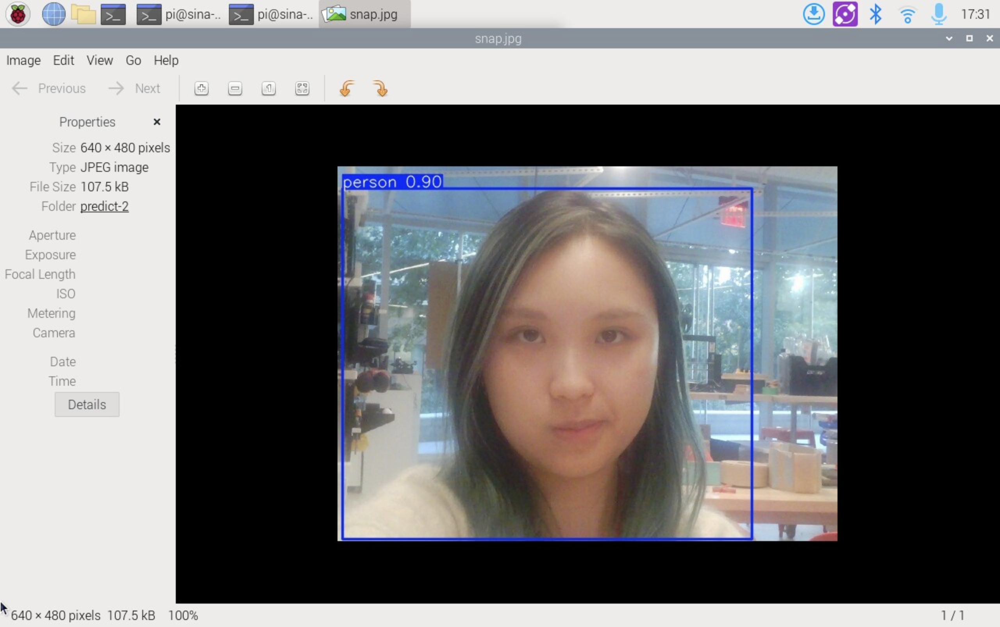

### Ollama models

I installed the two local Qwen models required for the lab: `qwen3.5:0.8b` for image and text understanding, and `qwen3:0.6b` for faster text-only responses.

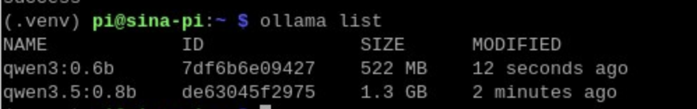

## Part B — Real-time person detection with YOLO

I ran `yolo_person.py` through Raspberry Pi Connect and tested the detector while moving into and out of frame, standing near and far from the camera, and showing different numbers of people. The detector drew boxes and confidence scores around each detected person.

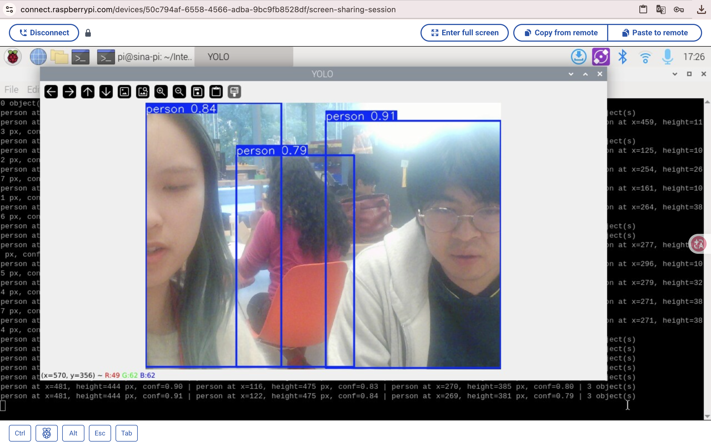

I also tested the headless mode, which prints the x-position, height, confidence, and number of detected people without opening a display window.

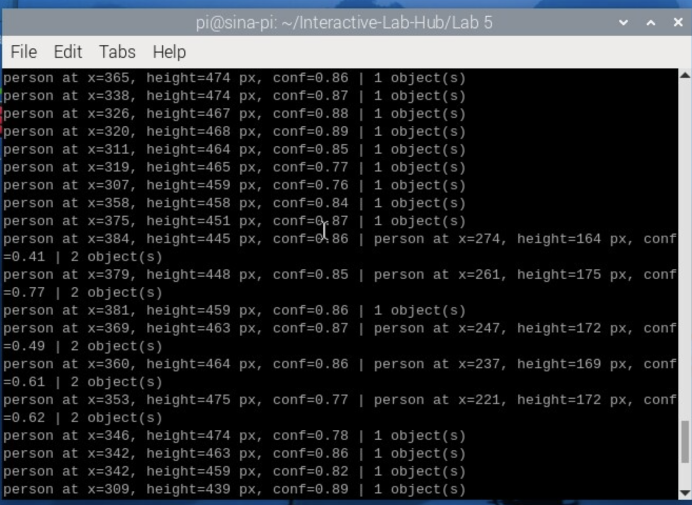

### Experiment recordings

| Recording | Command | What I tested |
| --- | --- | --- |
| [1](media/yolo-experiment-1.mp4) | `python yolo_person.py` | Baseline live person detection while moving close to, away from, and across the camera. |
| [2](media/yolo-experiment-2.mp4) | `python yolo_person.py --conf 0.2` | A lower confidence threshold, including a phone image with people in its background. |
| [3](media/yolo-experiment-3.mp4) | `python yolo_person.py --conf 0.7` | A higher confidence threshold and the difference between strong and weak detections. |
| [4](media/yolo-experiment-4.mp4) | `python yolo_person.py --headless` | The terminal-only output used when no display window is available. |

### Limits and errors I observed

1. In the baseline recording, moving extremely close to the camera left only a blurred, partial body in the frame. The detector could miss that view or draw a less stable box because there was not enough visible body shape for a reliable classification.
2. With `--conf 0.2`, the lowered threshold accepted weak detections. When I held up a phone image, YOLO also labeled the people inside the phone image/background as `person`, including low-confidence boxes around 0.20–0.39. This is a false positive for a system that needs to count physical people in the room.
3. With `--conf 0.7`, only stronger detections survived, so uncertain people were more likely to disappear. The phone itself was also recognized as a separate object in the experiment. This shows the tradeoff: a higher threshold reduces weak false positives but can hide real people, while object labels still depend on the visual context.

## Part C — Hand pose with MediaPipe

I ran `hand_pose.py` with the webcam. MediaPipe detected the 21 landmarks of my hand. The distance between my thumb and index finger controlled a percentage value; the screenshot below shows the value at 37%.

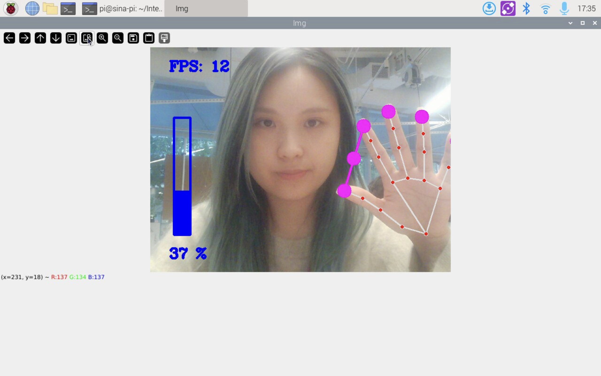

I then tested the gesture controls. Pinching my thumb and index finger adjusted the value from 0% to 84%. With the Quiet Coyote pose—index finger and pinky extended, middle and ring fingers folded, and thumb held against them—the program displayed `quiet coyote!` and set the value to 0%.

#### Pinch at 0%

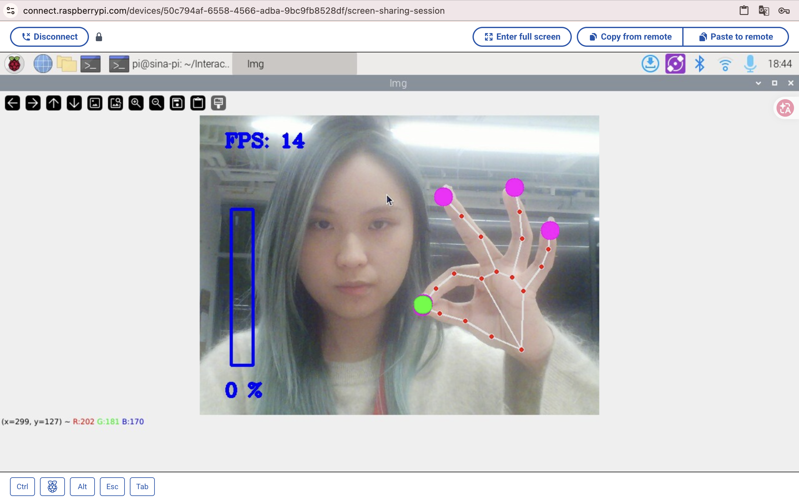

#### Pinch at 84%

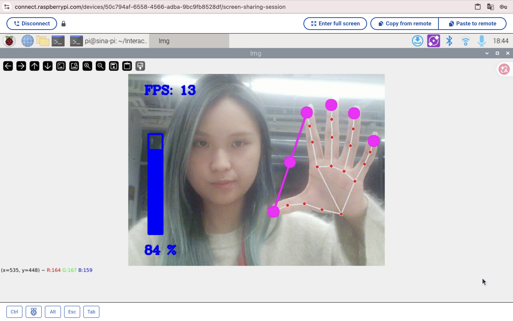

#### Quiet Coyote at 0%

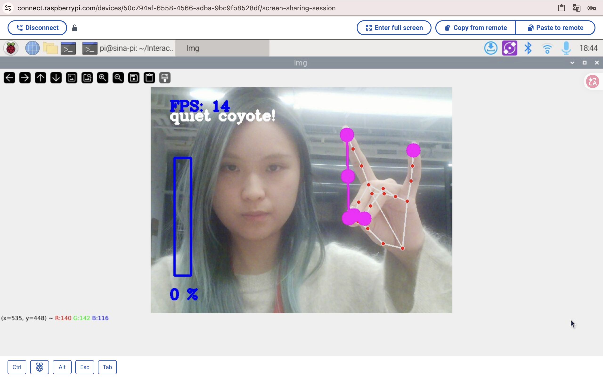

For an overnight interaction, this gesture could act as the hand-off ritual before bed: it mutes the device and starts the overnight observation mode. The morning report could require a second deliberate gesture before it is shown.

## Part D — Qwen reasoning on the Pi

I used `ask_qwen.py` to send my webcam image to the local `qwen3.5:0.8b` model with the question: **“What is in this photo?”** The model described a person in a workshop/studio setting and completed the request in 58.6 seconds.

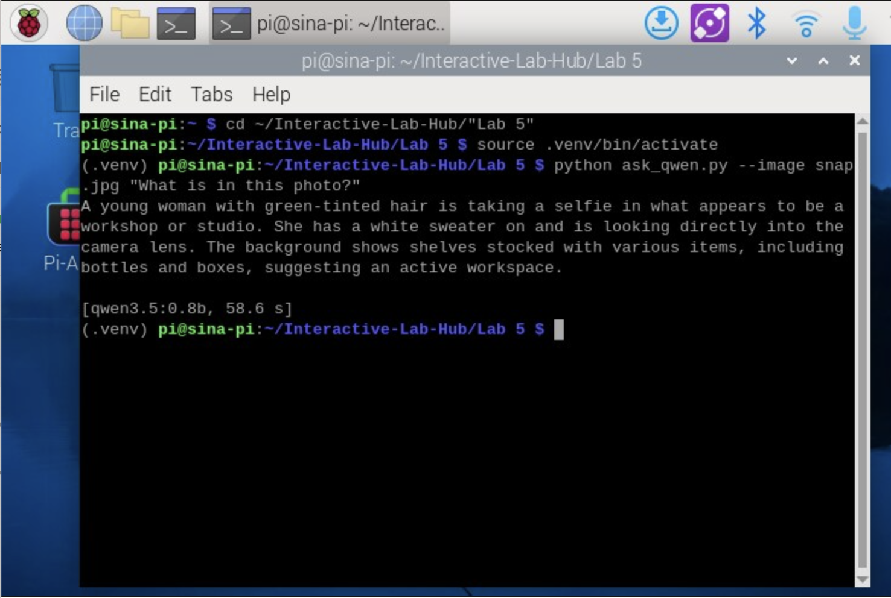

### Three text questions

I also asked the local `qwen3.5:0.8b` model three text questions:

| Question | Response summary | Time |
| --- | --- | --- |
| “When is Chinese Lunar New Year 2027?” | It answered “February 12, 2028,” which does not answer the requested year and is an example of the small model producing an incorrect factual response. | 10.4 s |
| “What is the color of rose?” | “The color of a rose is red.” | 1.6 s |
| “How to make a unagi don?” | It gave a short cooking procedure, but incorrectly suggested boiling the fish before slicing and frying it. | 8.0 s |

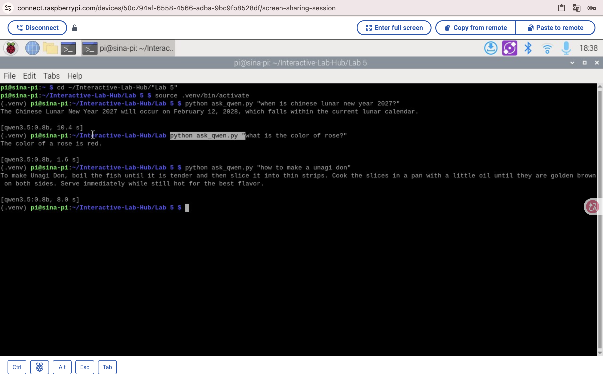

The answers show why an observant device should keep the model's task narrow and verify important claims against its input data rather than treating every answer as ground truth.

### Model comparison

I repeated the Lunar New Year question using `qwen3:0.6b`. The two small local models took almost the same amount of time, but neither response gave a reliable Gregorian date.

| Model | Result | Time |
| --- | --- | --- |
| `qwen3.5:0.8b` | Said Lunar New Year 2027 would be February 12, 2028, which is the wrong year. | 10.4 s |
| `qwen3:0.6b` | Gave a lunar-month description and incorrectly equated it with New Year's Day. | 10.3 s |

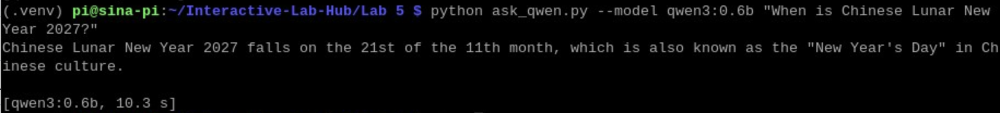

This comparison was only 0.1 seconds faster with the smaller model, and accuracy did not improve. For factual questions, a local model's answer should be checked against a reliable source before it is used in an interactive system.

## Part E — YOLO to Qwen pipeline

I ran `yolo_to_qwen.py` for 61 seconds. The script converted YOLO detections into time-stamped readings such as `1 person(s) at center/close`, saved 25 lines to `watch_log.txt`, and sent the log to Qwen for a summary.

Qwen reported that two people were initially near the center of the frame, that one later moved left/far, and that no new people appeared or disappeared during the observation interval. This result also shows a limitation: the summary is only as reliable as the detector log, so changes in camera framing and detector confidence can affect its account.

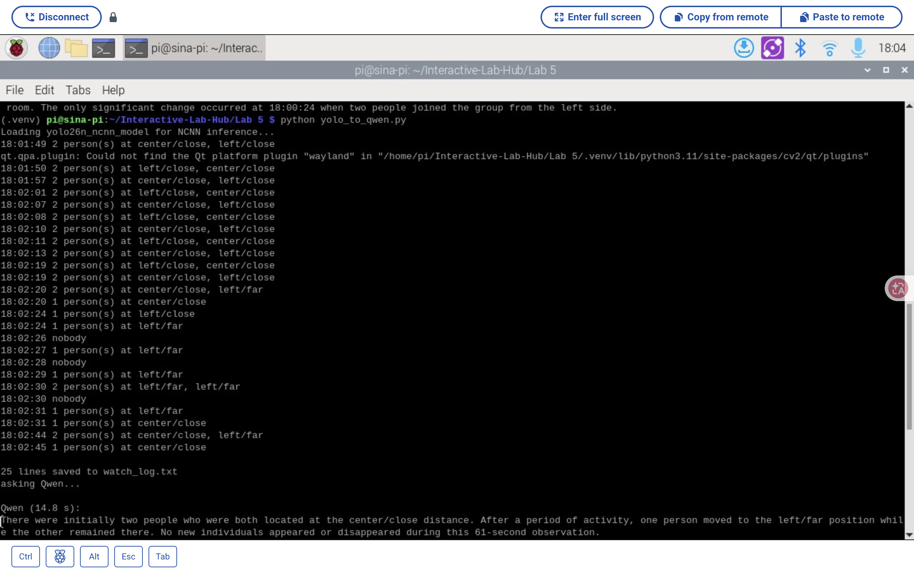

## Reflection

This lab helped me understand how the whole pipeline connects. YOLO first turns what the camera sees into boxes, then the script turns those boxes into short text readings, and Qwen only sees that text log rather than the original video. I was surprised that the live person detection still worked reasonably well on the Pi, while asking Qwen about an image took much longer.

The tests also made the limitations feel very clear. Changing the confidence threshold could either create extra detections or make a real person disappear, and Qwen gave wrong answers to some simple factual questions. I also realized that small choices in `interpret()`—for example, what counts as left, center, close, or far—change the story that Qwen receives. If I build this into an overnight project, I would need to keep the camera framing stable and treat the final AI summary as a helpful interpretation, not as unquestionable truth.

## Contributions

I performed the Raspberry Pi setup, webcam experiments, recordings, and on-device model runs. I used ChatGPT/Codex to troubleshoot installation issues and organize this documentation.
